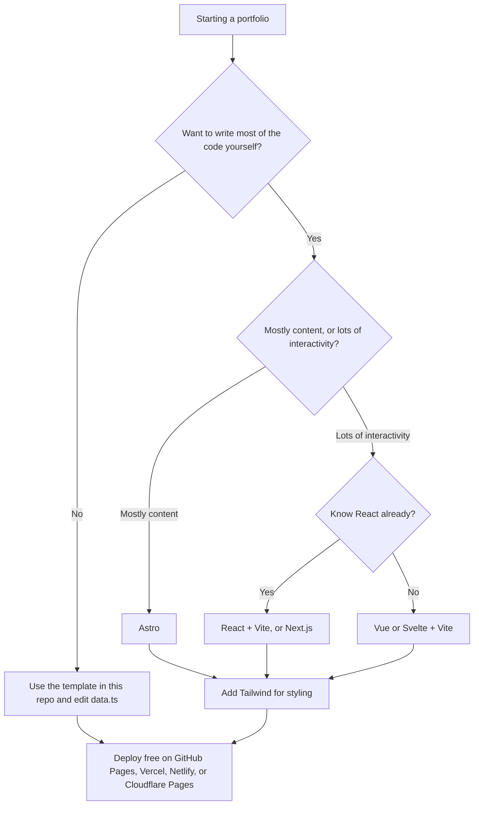

# Build a Portfolio

This repo is a portfolio template built with React, Vite, and TypeScript. All of your content lives in one file, `src/data.ts`, so you can fill in your whole site without touching the rest of the code. When you're ready to change more, the rest of this page covers the usual tools so you can choose what fits you.

**Filled out template repo example**: https://github.com/Flapjacck/built-portfolio

## Using this template

You need [Node.js](https://nodejs.org) (version 20.19 or newer) and [pnpm](https://pnpm.io). [SETUP.md](SETUP.md) walks through every step, including installing them.

```sh
pnpm install   # one time, installs everything
pnpm dev       # runs your site at http://localhost:5173
```

Then open `src/data.ts` and work through it from top to bottom. The page in your browser updates every time you save.

| Command | What it does |
|---|---|
| `pnpm dev` | Runs your site on your computer and updates it as you save |
| `pnpm build` | Checks your code for mistakes and builds the finished site into `dist/` |
| `pnpm preview` | Shows the finished `dist/` build, so you can check it before deploying |
| `pnpm lint` | Looks for common mistakes in the code |

### What you get

A single-page site with a sticky menu that scrolls smoothly to each section:

- **Hero:** your name, headline, a short pitch, location, an "open to" badge, your photo, "Download resume" and "Get in touch" buttons, and your social links.
- **About** with a few quick facts and your education, **Skills** in groups, **Experience** as a timeline, and **Projects** as cards (with pictures, tags, live and source links, and a bigger card for featured ones).
- **Extras:** certifications and awards, testimonials, and writing and talks. Empty any of them in `data.ts` and they disappear from the page and the menu.
- **Contact:** an "Email me" button, a one-click "copy my email" button, and your links.
- A light and dark mode toggle. It follows the visitor's device setting until they pick one, then remembers their choice.
- Your accent colour and font from `THEME` in `data.ts`, gentle fade-in animations (turned off for people who ask their device for less motion), and a layout that works on phones.
- The page title, description, and link-preview tags (what shows up when you paste your link into LinkedIn or a chat) are filled in from `SITE` in `data.ts`. Set `SITE.url` once your site is live so link previews can show `public/og-image.png`.

### Where things live

```text
public/              your files: photo.jpg, resume.pdf, project.png, og-image.png
src/data.ts          your content, links, and colours (start here)
src/App.tsx          puts the page together; reorder or add sections here
src/sections/        one file per section (Hero, About, Projects, ...)
src/components/      small shared pieces like the menu, tags, and icons
src/index.css        the styles (colours are variables at the top)
vite.config.ts       builds the page title and link-preview tags from data.ts
```

To move a section, change its place in the `SECTIONS` list in `src/App.tsx`. To add one, copy a file in `src/sections/` (like `Skills.tsx`), change it, and add it to that list.

## Picking a stack

Already know you want to build it your own way? Here's how people usually choose.



If you can't decide, **Astro + TypeScript + Tailwind** works well for most portfolios. This template uses React, Vite, and plain CSS so there's less to learn up front, but you can add Tailwind later.

## TypeScript or JavaScript

TypeScript is JavaScript with types added. Your editor can catch mistakes like a typo in a prop name or passing a string where a number belongs before you even run the code.

| | JavaScript | TypeScript |
|---|---|---|
| Setup | Nothing extra | Built into Vite, Astro, and Next.js templates |
| Learning curve | Lower | A bit higher at first |
| Catching bugs | When you run it | While you type |
| What employers use | Common | More common now, especially at companies |

For a small portfolio either one is fine. If you already know some JavaScript, try TypeScript anyway, since it's what most job postings ask for now. You can rename a `.js` file to `.ts` and add types gradually.

## Frameworks

A framework handles the repetitive parts of building pages, like reusing a navbar across pages or updating the screen when data changes.

### React

React is the most widely used option and the one you'll see in the most job postings. You build the site out of components, which are reusable pieces like a `ProjectCard` or a `Navbar`.

- **Pros:** huge community, a tutorial for almost anything, and it's the one employers ask for most often.
- **Cons:** by default the site ships a fair amount of JavaScript to the browser, even for pages that never change. You'll also have to choose separate tools for routing and other basics yourself.

### Astro

Astro is built for content-heavy sites like blogs, docs, and portfolios. It turns your pages into plain HTML when you build the site, so they load fast. You can still drop in React, Vue, or Svelte components wherever you need something interactive.

- **Pros:** very fast sites, simple to learn if you know HTML, built-in Markdown support for project write-ups or a blog, and you can mix in other frameworks.
- **Cons:** a poor fit for something app-like, such as a dashboard with lots of live state, and fewer job postings mention it.

### Vue and Svelte

Both do the same job as React. Many people find them easier to pick up because a component looks close to plain HTML, CSS, and JavaScript in one file.

- **Vue:** gentle learning curve, good documentation, and popular in a lot of companies.
- **Svelte:** very little extra code to write, and it ships small, fast sites. Its community is smaller than React's.

### Quick comparison

| | Best for | Learning curve | Speed out of the box | Job demand |
|---|---|---|---|---|
| React | Interactive sites, resume value | Medium | Good | Highest |
| Astro | Portfolios, blogs, content | Low | Excellent | Growing |
| Vue | Interactive sites | Low to medium | Good | Medium |
| Svelte | Small, fast sites | Low | Excellent | Lower |

## Vite, Next.js, and the rest

People mix these up because they all show up next to React. They do different jobs.

- **[Vite](https://vite.dev)** is a build tool. It runs your local dev server and bundles your code for production. It works with React, Vue, Svelte, or plain JavaScript. Start a project with `pnpm create vite` (or `npm create vite@latest`). This template is built with it.
- **[Next.js](https://nextjs.org)** is a full framework built on React. It adds file-based routing (a file in a folder becomes a page), server rendering, and API routes. It's a lot for a simple portfolio, but worth knowing.
- **[Nuxt](https://nuxt.com)** fills the same role for Vue that Next.js fills for React.
- **[Astro](https://astro.build)** uses Vite under the hood, so you get the fast dev server too.

A simple way to think about it: **Vite + React** is a toolkit you put together yourself, and **Next.js** comes with the decisions already made for you.

## Useful packages

### Styling

- **[Tailwind CSS](https://tailwindcss.com)** lets you style elements with small classes right in your markup, like `class="p-4 rounded-lg bg-black text-white"`. It's the most popular choice right now. It looks messy at first, but you'll stop jumping between CSS files.
- **[shadcn/ui](https://ui.shadcn.com)** gives you ready-made React components (buttons, dialogs, cards) built with Tailwind. You copy them into your project and edit them however you like.
- **[daisyUI](https://daisyui.com)** adds component classes on top of Tailwind, like `btn` and `card`, so you write less.
- **Plain CSS** is still completely fine. Modern CSS has variables, nesting, and grid built in.

### Animation

- **[Motion](https://motion.dev)** (formerly Framer Motion) handles smooth page transitions and scroll effects in React and plain JavaScript.
- A little goes a long way. Don't animate everything, because people visiting your portfolio want to find your projects quickly.

### Icons

- **[Lucide](https://lucide.dev)**: clean outline icons with packages for React, Vue, Svelte, and more.
- **[Heroicons](https://heroicons.com)**: made by the Tailwind team, so they fit well with Tailwind sites.
- **[Iconify](https://icon-sets.iconify.design)**: search over 200,000 icons across many sets in one place.

## Free logo and image resources

When you want the React logo next to a project or a row of "skills" icons:

- **[Simple Icons](https://simpleicons.org)**: thousands of brand logos as single-colour SVGs.
- **[SVGL](https://svgl.app)**: full-colour tech logos as SVG, with light and dark versions.
- **[Devicon](https://devicon.dev)**: icons for programming languages and dev tools, in a few styles.
- **[SVG Logos](https://svglogos.dev)**: a large collection of company and tech logos.
- **[unDraw](https://undraw.co)**: free illustrations you can recolour to match your site.
- **[Google Fonts](https://fonts.google.com)**: free fonts. Inter, Geist, and Space Grotesk are popular for portfolios.

Brand logos still belong to their companies. Using them to show which tools you've worked with is normal, but don't change them or use them in a way that suggests the company endorses you.

## Free hosting

All of these can deploy straight from your GitHub repo, and every push updates the site. This template builds to plain static files, so any of them works.

| Host | Good for | Notes |
|---|---|---|
| [GitHub Pages](https://pages.github.com) | Static sites (Astro, Vite) | Free `username.github.io` address |
| [Vercel](https://vercel.com) | Next.js, but anything works | Made by the Next.js team |
| [Netlify](https://www.netlify.com) | Any static site | Easy forms and redirects |
| [Cloudflare Pages](https://pages.cloudflare.com) | Any static site | Fast and generous free tier |

### Deploying this template

Push your copy of this repo to GitHub first. For every host, the build command is `pnpm build` and the folder to publish is `dist`.

- **Vercel:** click "Add New Project", import your repo, and press Deploy. It spots Vite and pnpm on its own.
- **Netlify:** click "Add new site", then "Import an existing project", and pick your repo. Set the build command to `pnpm build` and the publish directory to `dist`.
- **Cloudflare Pages:** go to Workers & Pages, create a Pages project from Git, pick your repo, choose the "React (Vite)" preset (or set `pnpm build` and `dist` yourself), and deploy.
- **GitHub Pages:** in your repo go to Settings, then Pages, and set Source to "GitHub Actions". Then add this file as `.github/workflows/deploy.yml` and push:

```yaml
name: Deploy to GitHub Pages

on:
  push:
    branches: [main]
  workflow_dispatch:

permissions:
  contents: read
  pages: write
  id-token: write

jobs:
  deploy:
    runs-on: ubuntu-latest
    environment:
      name: github-pages
      url: ${{ steps.deployment.outputs.page_url }}
    steps:
      - uses: actions/checkout@v4
      - uses: pnpm/action-setup@v4
      - uses: actions/setup-node@v4
        with:
          node-version: 22
          cache: pnpm
      - run: pnpm install --frozen-lockfile
      - run: pnpm build
      - uses: actions/upload-pages-artifact@v3
        with:
          path: dist
      - id: deployment
        uses: actions/deploy-pages@v4
```

Your site will be at `https://your-username.github.io/your-repo-name/`. It works from a sub-folder like that because `vite.config.ts` sets `base: './'`.

## Starter combos

| If you want... | Try |
|---|---|
| The fastest path, just fill in your details | The React template in this repo |
| A fast, simple portfolio | Astro + TypeScript + Tailwind |
| To practise what jobs ask for | React + Vite + TypeScript + Tailwind |
| A full framework to learn | Next.js + Tailwind + shadcn/ui |
| Something easy to read and learn | Vue + Vite or Svelte + Vite |

Most people who visit a portfolio look at your projects, your contact info, and maybe your resume. The stack matters less than having a few projects with clear write-ups and links that actually work.
